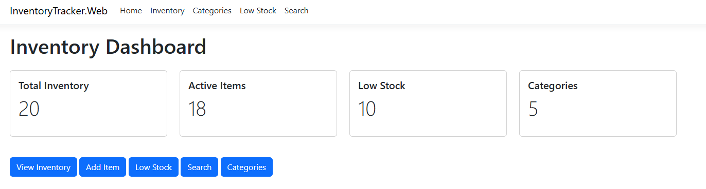
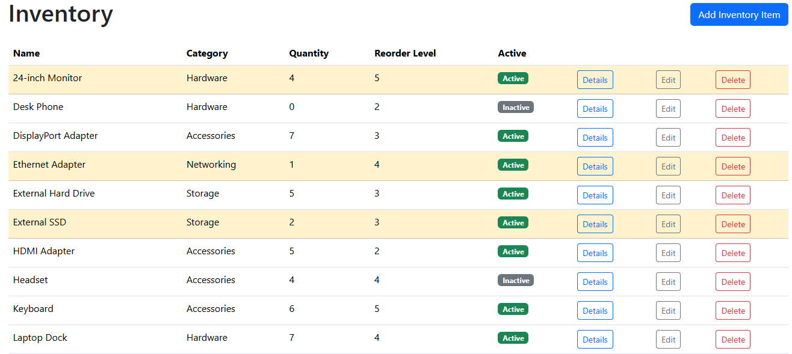
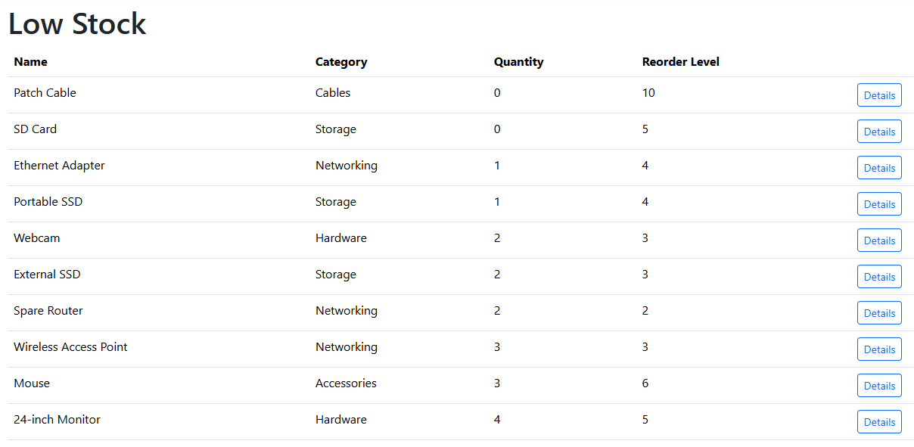
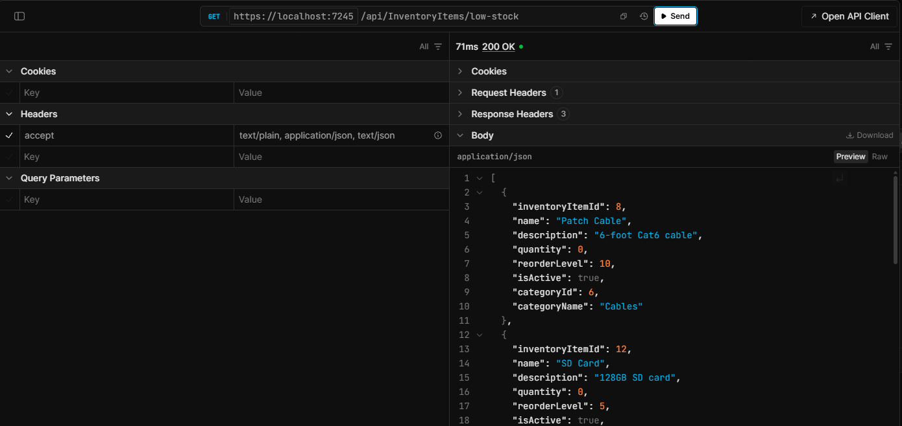

# InventoryTracker

InventoryTracker is a full-stack inventory management application built with C# and .NET 10. It provides a web interface for managing inventory items and categories, monitoring stock levels, and searching inventory.

The application uses ASP.NET Core Web API, Razor Pages, Entity Framework Core, and SQLite, with separate projects for the domain, data access, API, and user interface. I built this project to gain hands-on experience designing, developing, testing, and integrating the components of a complete .NET application.


## Features

### Dashboard

- View the count of the total inventory items, active inventory items, low-stock items, and categories.

### Inventory and Category Management

- Create, view, edit, and delete inventory items.
- Create, view, edit, and delete categories.
- Prevent deletion of categories that contain inventory items.
- Track inventory quantities, reorder levels, and active status.

### Low-Stock Monitoring and Search

- Identify active inventory items whose quantity is at or below their reorder level.
- Search inventory items by name or description, with support for `*` wildcard patterns.
- Filter inventory by category through the REST API.

### Validation and Testing

- Validate input at both the Web and API layers.
- Provide user-facing error feedback and appropriate HTTP status codes.
- Verify domain behavior and API functionality through automated tests.
- Present the user interface using Razor Pages and Bootstrap.


## Screenshots

### Dashboard



### Inventory List



### Low Stock



### REST API Request and Response



### Additional Screenshots

- [Item Details](docs/screenshots/item-details.png)
- [Create Item](docs/screenshots/create-item.png)
- [Categories](docs/screenshots/categories.png)
- [Search](docs/screenshots/search.png)
- [API Overview](docs/screenshots/api-overview.png)
- [Full API Reference](docs/screenshots/api-full-reference.jpeg)


## Technology Stack

| Area | Technologies |
| --- | --- |
| Language and runtime | C#, .NET 10 |
| Backend | ASP.NET Core Web API, REST, JSON |
| Frontend | ASP.NET Core Razor Pages, Bootstrap, HttpClient |
| Data access | Entity Framework Core, LINQ, SQLite |
| Testing | xUnit, WebApplicationFactory, Microsoft.Testing.Platform |
| API documentation | OpenAPI, Scalar API Reference |
| Version control | Git, GitHub |


## Architecture

The application separates the user interface, API, data access, and domain model so each project has a defined responsibility.

```text
Browser
 |
 v
InventoryTracker.Web (Razor Pages)
 | HTTP / JSON via HttpClient
 v
InventoryTracker.Api (Controllers and DTOs)
 | EF Core queries and operations
 v
InventoryTracker.Data (DbContext and configuration)
 |
 v
SQLite database
```

The API and Data projects use the entities defined in InventoryTracker.Domain. The Web project communicates with the API rather than accessing the database directly. DTOs define the data exchanged through the API, while view models represent the data used by the Web application.

## Solution Structure

| Project | Responsibility |
| --- | --- |
| `InventoryTracker.Domain` | Domain entities and relationships |
| `InventoryTracker.Data` | EF Core DbContext, entity configurations, migrations, and database configuration |
| `InventoryTracker.Api` | REST API controllers, DTOs, validation, and business rules |
| `InventoryTracker.Web` | Razor Pages, view models, and API communication |
| `InventoryTracker.Console` | Early development and persistence testing |
| `InventoryTracker.Tests` | Domain unit tests and API integration tests |


## Database Design

The application models a one-to-many relationship between categories and inventory items. Each inventory item belongs to one category, while a category can contain multiple inventory items.

```text
Category (1) -------- (*) InventoryItem
CategoryId                InventoryItemId
Name                      Name
                          Description
                          Quantity
                          ReorderLevel
                          IsActive
                          CategoryId (FK)
```

Entity Framework Core manages the relationship mapping and database schema through entity configurations and migrations. Low-stock status is determined from quantity, reorder level, and active status rather than stored as a separate database field.


## REST API Endpoints

### Inventory Items

| Method | Endpoint | Purpose |
| --- | --- | --- |
| GET | `/api/InventoryItems` | List inventory items |
| GET | `/api/InventoryItems/{id}` | Retrieve an inventory item |
| POST | `/api/InventoryItems` | Create an inventory item |
| PUT | `/api/InventoryItems/{id}` | Update an inventory item |
| DELETE | `/api/InventoryItems/{id}` | Delete an inventory item |
| GET | `/api/InventoryItems/low-stock` | List active low-stock items |
| GET | `/api/InventoryItems/category/{categoryId}` | List items in a category |
| GET | `/api/InventoryItems/category/{categoryId}/low-stock` | List active low-stock items in a category |
| GET | `/api/InventoryItems/search?term={searchTerm}` | Search inventory items |


### Categories

| Method | Endpoint | Purpose |
| --- | --- | --- |
| GET | `/api/Categories` | List categories |
| GET | `/api/Categories/{id}` | Retrieve a category |
| POST | `/api/Categories` | Create a category |
| PUT | `/api/Categories/{id}` | Update a category |
| DELETE | `/api/Categories/{id}` | Delete an empty category |


### Dashboard

| Method | Endpoint | Purpose |
| --- | --- | --- |
| GET | `/api/Dashboard` | Retrieve dashboard summary counts |

## Search Behavior

Inventory searches match item names and descriptions. By default, a search term matches items containing the supplied text. Simple wildcard patterns are also supported:

| Search | Behavior |
| --- | --- |
| `usb` | Contains "usb" |
| `usb*` | Starts with "usb" |
| `*usb` | Ends with "usb" |
| `*usb*` | Contains "usb" |

The application converts `*` into the SQL `LIKE` wildcard `%` when building the EF Core search query.


## Validation and Error Handling

Both the Web application and the API validate incoming data. Validation and business rules include:

- Inventory and category names are required.
- Text fields have maximum lengths.
- Quantities and reorder levels must be non-negative.
- Inventory items must belong to an existing category.
- Categories containing inventory items cannot be deleted.

- The Web interface provides error feedback, while the API independently validates requests, including requests originating outside the Web application.


## Automated Testing

The test project contains domain unit tests and API integration tests. Integration tests use xUnit, WebApplicationFactory, and isolated SQLite in-memory databases to execute HTTP requests against the API without modifying the application's local database.

Test coverage includes:

- New inventory items default to active.
- Requests for missing inventory items return `404 Not Found`.
- Requests for existing inventory items return the expected DTO.
- Invalid Category IDs return `400 Bad Request`.
- Categories containing inventory items cannot be deleted.
- Empty categories can be deleted, and subsequent requests return `404 Not Found`.
- The low-stock endpoint returns only active items meeting the low-stock criteria.

Run the test suite from the solution directory:

```powershell
dotnet test
```

The root `global.json` configures Microsoft.Testing.Platform as the `dotnet test` runner for the .NET 10 SDK.


## Getting Started

### Requirements

- .NET 10 SDK
- Git
- Entity Framework Core CLI (`dotnet-ef`), compatible with the project's EF Core version
- Visual Studio 2026 or another .NET-compatible IDE (optional for command-line use)

### 1. Clone the Repository

```powershell
git clone https://github.com/RobertMoore2052/InventoryTrackerv2.git
cd InventoryTrackerv2
```

### 2. Restore Dependencies and Build

```powershell
dotnet restore
dotnet build
```

### 3. Set Up the Database

InventoryTracker uses SQLite for local database storage and EF Core migrations to manage the database schema. Verify that the EF Core CLI is installed:

```powershell
dotnet ef --version
```

If necessary, install the CLI tool with a version compatible with the project's EF Core packages. Apply the migrations from the solution directory:

```powershell
dotnet ef database update --project InventoryTracker.Data --startup-project InventoryTracker.Api
```

A newly initialized database may be empty. Categories and inventory items can be created using the Web application after startup.

### 4. Run the Application

The API and Web projects must both be running. In Visual Studio:

1. Right-click the solution and select **Properties**.
2. Under **Configure Startup Projects**, select **Multiple startup projects**.
3. Set `InventoryTracker.Api` and `InventoryTracker.Web` to **Start**. Set the remaining projects to **None**.
4. Start debugging with **F5**.

Alternatively, run the two projects in separate terminals from the solution directory:

```powershell
# Terminal 1
dotnet run --project InventoryTracker.Api
```

```powershell
# Terminal 2
dotnet run --project InventoryTracker.Web
```

Ensure the `ApiBaseUrl` setting in `InventoryTracker.Web/appsettings.json` matches the address of the running API. Open the Web application's displayed local URL in your browser. In the API's Development environment, the Scalar API reference is available at `/scalar`.


## What I Learned

My main goal with this project was to understand how the different parts of a .NET application work together. Throughout development, I gained practical experience with:

- Designing relational domain models and configuring one-to-many relationships.
- Managing database schemas with EF Core migrations and executing asynchronous LINQ queries.
- Building REST APIs with controllers, DTOs, HTTP status codes, and dependency injection.
- Working with Razor Pages model binding and API communication through HttpClient.
- Implementing validation and enforcing business rules across application layers.
- Writing integration tests with isolated databases.
- Debugging issues across the Web, API, and data access layers.

Working through an entire application gave me a better understanding of how architectural decisions affect maintainability, testing, and communication between projects.

## Project Status

The core application is complete, including inventory and category management, search, low-stock monitoring, dashboard reporting, validation, and automated testing.

The project currently runs locally. Public deployment is a potential future enhancement.

This project serves as a practical demonstration of my experience building, testing, and organizing a full-stack .NET application.
